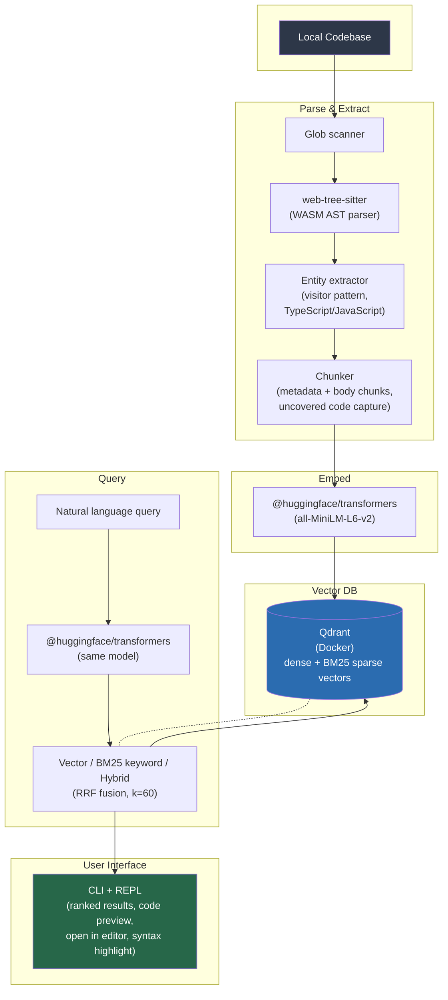

# ASTra — Semantic Code Search

A CLI tool that indexes local codebases using **AST parsing** (not regex) and lets you ask **natural-language questions** to find code by file and line number.

Built with `web-tree-sitter` for AST parsing, `@huggingface/transformers` v3 for local embeddings, and Qdrant for vector search (dense + BM25 sparse vectors).

## How it works



## Prerequisites

- **Node.js** >= 20 (or the version in your `package.json` `engines` field)
- **npm** >= 10
- **C++ compiler toolchain** — required by the native `better-sqlite3` module:
  - **Linux**: `python3`, `make`, `gcc`, `g++` (`sudo apt install build-essential`)
  - **macOS**: Xcode Command Line Tools (`xcode-select --install`)
  - **Windows**: Visual Studio Build Tools (see [node-gyp docs](https://github.com/nodejs/node-gyp#on-windows))
- **Docker** — for running Qdrant (see `docker-compose.yml`)

## Quick start

```bash
# 1. Start Qdrant (Docker)
docker compose up -d

# 2. Init config (interactive wizard)
astra init /path/to/project

# 3. Index a codebase
astra index /path/to/project

# 4. Search with natural language
astra query "Where is the authentication middleware?"
astra query "Which function handles payment webhooks?" --limit 5 --mode hybrid
astra query "auth middleware" -C /path/to/project     # from any directory
```

## CLI commands

| Command | Description |
|---------|-------------|
| `astra init [path]` | Interactive wizard — prompts for directories, extensions, excludes; creates \`astra.config.json\` with ASCII banner |
| `astra index [path]` | Index a directory: parses ASTs, extracts entities, generates chunks (metadata + body), embeds with Transformers.js, and stores in Qdrant. Shows progress bars for model download and indexing. Uses SQLite cache for incremental re-indexing. |
| `astra query [query]` | Search with a natural language query. Omit for **interactive REPL** (`:help`, `:clear`, `:history`, `:limit N`, `:mode M`, `:exit`). Supports `-n, --limit N`, `-m, --mode vector\|keyword\|hybrid`, and `-C, --dir <path>` to specify project root from any directory. Results include code preview with syntax highlighting and an "Open in editor" menu. |
| `astra status [-C, --dir <path>]` | Show index statistics — total files, total chunks, last indexed timestamp, vector size (model-dependent: 384/768/1024), Qdrant URL, model ID |
| `astra verify [-C, --dir <path>] [--fix]` | Verify index integrity — compares SQLite cache against Qdrant, reports missing/orphaned/mismatched files. Use `--fix` to automatically repair: deletes orphaned and mismatched Qdrant points, removes mismatched files from cache, and flags missing files for re-index on next `astra index`. |
| `astra reset [-C, --dir <path>]` | Clear the index and Qdrant collection. Prompts for confirmation before deleting. |

## What it extracts from code

- **Functions** / Arrow functions (name, params, return type, line range)
- **Methods** (class/object methods)
- **Classes** (name, extends, line range)
- **Interfaces** (name, members, line range)
- **Type aliases**
- **Enums**
- **Variables** (const/let/var declarations)
- **Re-exports and barrel exports** (e.g. `export { x } from './y'`, `export * from './z'`);
  declaration exports like `export class` are indexed under the declaration's own type, not "export".
- **Imports** (import declarations)
- **Decorators** (NestJS/Angular decorators)
- **JSDoc** comments attached to each entity

Each entity produces a **metadata chunk** (signature + JSDoc) and a **body chunk** (implementation), indexed alongside semantic embeddings for richer retrieval. Metadata chunks are omitted when the signature is very short and no JSDoc is attached. Code between entities (e.g. top-level `app.use()` calls, startup logic) is also captured as separate body chunks so nothing is missed.

## Architecture

```
semantic-code-search/
├── packages/
│   ├── core/              # AST parsing, chunking, embeddings, Qdrant indexing
│   │   ├── package.json
│   │   ├── tsconfig.json
│   │   ├── vitest.config.ts
│   │   └── src/
│   │       ├── index.ts       # Barrel exports
│   │       ├── config.ts      # astra.config.json loader (Zod-validated)
│   │       ├── scanner.ts     # File discovery (glob + .gitignore)
│   │       ├── languages.ts   # web-tree-sitter WASM grammar init
│   │       ├── parser.ts      # Parse source into tree-sitter AST
│   │       ├── entities.ts    # Walk AST → extract via visitor registry
│   │       ├── visitors/      # Language-specific entity handlers
│   │       │   ├── index.ts       # Module barrel
│   │       │   ├── types.ts       # EntityHandler type
│   │       │   ├── registry.ts    # Language → handler map
│   │       │   ├── doc-comment.ts # JSDoc comment extraction
│   │       │   ├── ts-visitor.ts  # TypeScript/JavaScript handlers
│   │       │   └── __tests__/
│   │       │       └── ts-visitor.test.ts
│   │       ├── chunker.ts     # Group entities into indexable chunks
│   │       ├── embedder.ts    # @huggingface/transformers (all-MiniLM-L6-v2)
│   │       ├── indexer.ts     # Qdrant upsert/delete/collection management
│   │       ├── query.ts       # Vector / BM25 keyword / Hybrid search (RRF)
│   │       ├── cache.ts       # SQLite cache for incremental indexing
│   │       ├── qdrant.ts      # Qdrant client creation & safe-call helpers
│   │       ├── errors.ts      # Custom error classes & helpers
│   │       ├── types.ts       # Shared TypeScript type definitions
│   │       └── __tests__/     # Vitest test suite (12 files)
│   │           ├── cache.test.ts
│   │           ├── chunker.test.ts
│   │           ├── config.test.ts
│   │           ├── doc-comment.test.ts
│   │           ├── embedder.test.ts
│   │           ├── entities.test.ts
│   │           ├── errors.test.ts
│   │           ├── indexer.test.ts
│   │           ├── languages.test.ts
│   │           ├── query.test.ts
│   │           ├── rrf-merge.test.ts
│   │           └── scanner.test.ts
│   └── cli/               # CLI: init, index, query, status, verify, reset
│       ├── package.json
│       ├── tsconfig.json
│       └── src/
│           ├── index.ts         # Commander entry point
│           ├── commands/        # Command handlers
│           │   ├── index-cmd.ts # astra index
│           │   ├── init.ts      # astra init
│           │   ├── query.ts     # astra query + REPL
│           │   ├── reset.ts     # astra reset
│           │   ├── status.ts    # astra status
│           │   └── verify.ts    # astra verify [--fix]
│           ├── utils/
│           │   ├── config.ts    # Config loader (Zod validation helper)
│           │   └── progress.ts  # Progress bar manager (cli-progress)
│           └── __tests__/     # Vitest test suite (2 files)
│               ├── commands.test.ts
│               └── init.test.ts
├── docker-compose.yml     # Qdrant vector DB (v1.18.2)
├── tsconfig.base.json     # Shared TS config
├── turbo.json             # Turborepo task definitions
└── astra.config.json      # User configuration
```

## Search modes

Use `--mode` / `-m` to control how queries are matched:

| Mode | Behavior |
|------|----------|
| `vector` | Cosine similarity on model-dim dense embeddings (semantic meaning) — uses named vector `"dense"` |
| `keyword` | Full-text BM25 keyword search via Qdrant server-side sparse vectors — uses named vector `"bm25"` |
| `hybrid` | RRF (Reciprocal Rank Fusion, k=60) — merges vector + keyword results with a metadata relevance boost |

Default is `hybrid`.

## Configuration (\`astra.config.json\`)

```json
{
  "include": [
    "src/**/*.ts", "src/**/*.tsx",
    "src/**/*.js", "src/**/*.jsx"
  ],
  "exclude": [
    "**/node_modules/**", "**/dist/**", "**/build/**",
    "**/*.test.ts", "**/*.spec.ts", "**/*.d.ts"
  ],
  "qdrantUrl": "http://localhost:6333",
  "collectionName": "code_chunks",
  "modelId": "Xenova/all-MiniLM-L6-v2",
  "maxChunkSize": 50,
  "maxBodyLines": 150,
  "maxBodyChars": 4000,
  "linesPerBodyChunk": 100,
  "chunkOverlap": 25
}
```

Validated at runtime with **Zod** — misconfigured values produce clear error messages.

> `maxChunkSize` is a legacy fallback that only applies when a file has **zero AST entities** (e.g. plain config files). In that case, the file is split into fixed-size windows of this many lines. When entities are present, chunking is driven by the other four options: `maxBodyLines` (150), `maxBodyChars` (4000), `linesPerBodyChunk` (100), and `chunkOverlap` (25).

## Interactive REPL

Running `astra query` without arguments starts a REPL:

```
  Type :help for REPL commands. Ctrl+C to quit.

  › find the user handler
  ◐ Searching...
```

| Command | Purpose |
|---------|---------|
| `:help` | Show available commands |
| `:clear` | Clear the screen |
| `:history` | Show previous query history |
| `:limit N` | Set result limit (e.g. `:limit 5`) |
| `:mode M` | Set search mode: `vector`, `keyword`, or `hybrid` |
| `:exit` | Exit the REPL |

## Tech stack

| Component | Technology |
|-----------|-----------|
| AST Parser | `web-tree-sitter` (WASM, TypeScript/JavaScript) |
| Embeddings | `Xenova/all-MiniLM-L6-v2` via `@huggingface/transformers` v3 |
| Vector DB | Qdrant (Docker v1.18.2), Cosine distance, model-dim dense + BM25 sparse vectors |
| Search modes | Vector (dense) + BM25 keyword (sparse) + Hybrid (RRF fusion, k=60) |
| Cache | SQLite via `better-sqlite3` (per-project, `.astra/cache/`) |
| Config validation | Zod |
| Progress bars | `cli-progress` |
| Syntax highlighting | `emphasize` |
| CLI | Commander + Clack prompts |
| Monorepo | Turborepo, TypeScript ESM |

> Query latency ~800ms on a 112-file TypeScript codebase (WSL, local Qdrant). Model initialization adds ~3–4s on first invocation; subsequent queries in REPL mode skip this.

## Example queries

```
astra query "Where is the authentication middleware?"
# → server/app/controllers/auth/auth.controller.ts:9-24
#   class AuthController with @Controller('auth')

astra query "database schema or prisma models"
# → server/src/schema.prisma:1-120
#   Prisma schema with User, Post models

astra query "UI components and layout"
# → src/app/layout.tsx:20-34
#   function RootLayout with React children
```
