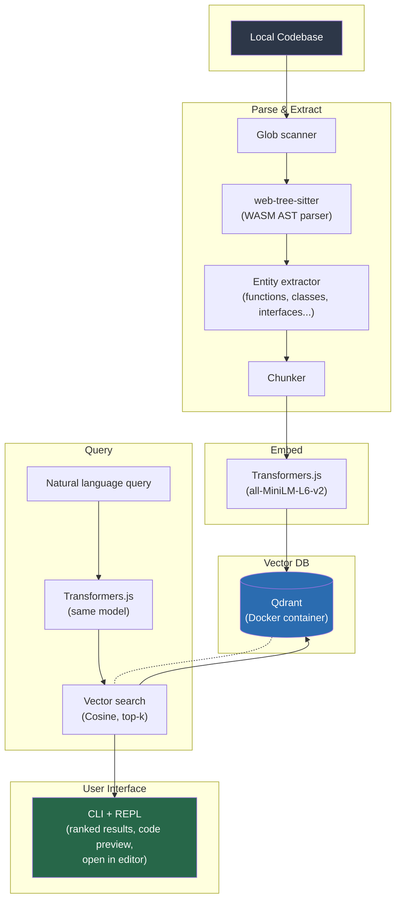

# Semantic Code Search (`scs`)

A CLI tool that indexes local codebases using **AST parsing** (not regex) and lets you ask **natural-language questions** to find code by file and line number.

Built with `web-tree-sitter` for AST parsing, `Transformers.js` for local embeddings, and Qdrant for vector search.

## How it works



## Quick start

```bash
# 1. Start Qdrant (Docker)
docker compose up -d

# 2. Init config (optional)
scs init /path/to/project

# 3. Index a codebase
scs index /path/to/project

# 4. Search with natural language
scs query "Where is the authentication middleware?"
scs query "Which function handles payment webhooks?" --limit 5
```

## CLI commands

| Command | Description |
|---------|-------------|
| `scs init [path]` | Create a default `scs.config.json` |
| `scs index [path]` | Index a directory for semantic search |
| `scs query [query]` | Search with a natural language query (omit for interactive mode) |
| `scs status` | Show index statistics |
| `scs reset` | Clear the index and re-index from scratch |

## What it extracts from code

- **Functions** / Arrow functions (name, params, return type, line range)
- **Methods** (class/object methods)
- **Classes** (name, extends, line range)
- **Interfaces** (name, members, line range)
- **Type aliases**
- **Enums**
- **Decorators** (NestJS/Angular decorators)
- **JSDoc** comments attached to each entity

## Architecture

```
semantic-code-search/
├── packages/
│   ├── core/          # AST parsing, chunking, embeddings, Qdrant indexing
│   │   └── src/
│   │       ├── scanner.ts   # File discovery (glob + .gitignore)
│   │       ├── languages.ts # web-tree-sitter WASM grammar init
│   │       ├── parser.ts    # Parse source into tree-sitter AST
│   │       ├── entities.ts  # Walk AST → extract code entities
│   │       ├── chunker.ts   # Group entities into indexable chunks
│   │       ├── embedder.ts  # Transformers.js (all-MiniLM-L6-v2)
│   │       ├── indexer.ts   # Qdrant upsert/delete/collection management
│   │       ├── query.ts     # Vector search → ranked results
│   │       ├── cache.ts     # SQLite cache for incremental indexing
│   │       └── config.ts    # scs.config.json loader
│   └── cli/            # CLI: init, index, query, status, reset
│       └── src/
│           ├── index.ts         # Commander entry point
│           └── commands/        # Command handlers
├── docker-compose.yml   # Qdrant vector DB
└── scs.config.json      # User configuration
```

## Configuration (`scs.config.json`)

```json
{
  "include": ["src/**/*.ts", "src/**/*.tsx"],
  "exclude": ["**/node_modules/**", "**/dist/**"],
  "qdrantUrl": "http://localhost:6333",
  "collectionName": "code_chunks",
  "modelId": "Xenova/all-MiniLM-L6-v2",
  "maxChunkSize": 50
}
```

## Tech stack

| Component | Technology |
|-----------|-----------|
| AST Parser | `web-tree-sitter` (WASM, multi-language) |
| Embeddings | `Xenova/all-MiniLM-L6-v2` via Transformers.js |
| Vector DB | Qdrant (Docker), Cosine distance, 384-dim |
| Cache | SQLite via `better-sqlite3` |
| CLI | Commander + Clack prompts |
| Monorepo | Turborepo, TypeScript ESM |

## Example queries

```
scs query "Where is the authentication middleware?"
# → server/app/controllers/auth/auth.controller.ts:9-24
#   class AuthController with @Controller('auth')

scs query "database schema or prisma models"
# → server/src/schema.prisma:1-120
#   Prisma schema with User, Post models

scs query "UI components and layout"
# → src/app/layout.tsx:20-34
#   function RootLayout with React children
```
