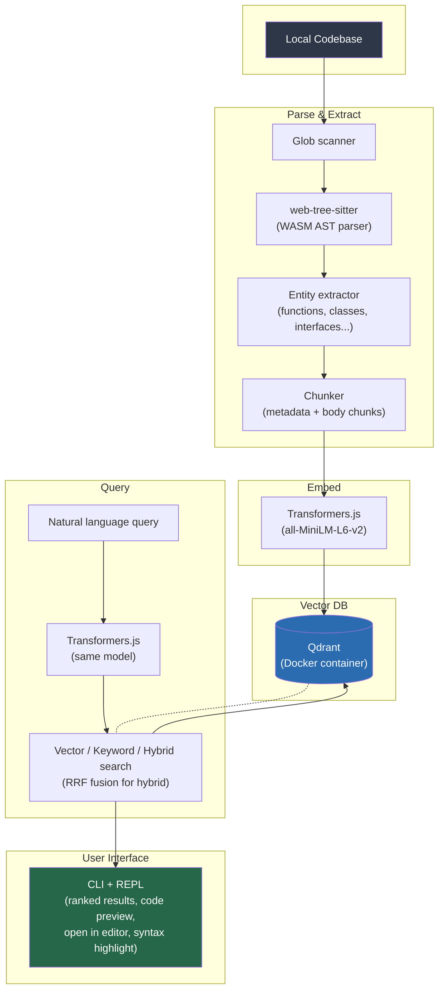

# ASTra — Semantic Code Search

A CLI tool that indexes local codebases using **AST parsing** (not regex) and lets you ask **natural-language questions** to find code by file and line number.

Built with `web-tree-sitter` for AST parsing, `Transformers.js` for local embeddings, and Qdrant for vector search.

## How it works



## Quick start

```bash
# 1. Start Qdrant (Docker)
docker compose up -d

# 2. Init config (interactive wizard)
astra init /path/to/project

# 3. Index a codebase
astra index /path/to/project

# 4. Search with natural language
astra query "Where is the authentication middleware?"
astra query "Which function handles payment webhooks?" --limit 5 --mode hybrid
astra query "auth middleware" -C /path/to/project     # from any directory
```

## CLI commands

| Command | Description |
|---------|-------------|
| `astra init [path]` | Interactive wizard — prompts for directories, extensions, excludes; creates \`astra.config.json\` with ASCII banner |
| `astra index [path]` | Index a directory: parses ASTs, extracts entities, generates chunks (metadata + body), embeds with Transformers.js, and stores in Qdrant. Shows progress bars for model download and indexing. Uses SQLite cache for incremental re-indexing. |
| `astra query [query]` | Search with a natural language query. Omit for **interactive REPL** (`:help`, `:clear`, `:history`, `:limit N`, `:mode M`, `:exit`). Supports `--limit N`, `--mode vector\|keyword\|hybrid`, and `-C, --dir <path>` to specify project root from any directory. Results include code preview with syntax highlighting and an "Open in editor" menu. |
| `astra status [-C, --dir <path>]` | Show index statistics — collection name, total chunks, vector size (384), Qdrant URL, model ID |
| `astra reset [-C, --dir <path>]` | Clear the index and Qdrant collection. Prompts for confirmation before deleting. |

## What it extracts from code

- **Functions** / Arrow functions (name, params, return type, line range)
- **Methods** (class/object methods)
- **Classes** (name, extends, line range)
- **Interfaces** (name, members, line range)
- **Type aliases**
- **Enums**
- **Variables** (const/let/var declarations)
- **Exports** (named and default export declarations)
- **Imports** (import declarations)
- **Decorators** (NestJS/Angular decorators)
- **JSDoc** comments attached to each entity

Each entity is dual-chunked into a **metadata chunk** (signature + JSDoc) and a **body chunk** (implementation), indexed alongside semantic embeddings for richer retrieval.

## Architecture

```
semantic-code-search/
├── packages/
│   ├── core/              # AST parsing, chunking, embeddings, Qdrant indexing
│   │   └── src/
│   │       ├── config.ts      # astra.config.json loader (Zod-validated)
│   │       ├── scanner.ts     # File discovery (glob + .gitignore)
│   │       ├── languages.ts   # web-tree-sitter WASM grammar init
│   │       ├── parser.ts      # Parse source into tree-sitter AST
│   │       ├── entities.ts    # Walk AST → extract code entities
│   │       ├── chunker.ts     # Group entities into indexable chunks
│   │       ├── embedder.ts    # Transformers.js (all-MiniLM-L6-v2)
│   │       ├── indexer.ts     # Qdrant upsert/delete/collection management
│   │       ├── query.ts       # Vector / Keyword / Hybrid search
│   │       ├── cache.ts       # SQLite cache for incremental indexing
│   │       ├── errors.ts      # Custom error classes & helpers
│   │       └── types.ts       # Shared TypeScript type definitions
│   └── cli/               # CLI: init, index, query, status, reset
│       └── src/
│           ├── index.ts         # Commander entry point
│           ├── commands/        # Command handlers
│           └── utils/
│               └── progress.ts  # Progress bar manager (cli-progress)
├── docker-compose.yml     # Qdrant vector DB
├── tsconfig.base.json     # Shared TS config
├── turbo.json             # Turborepo task definitions
└── astra.config.json        # User configuration
```

## Search modes

Use `--mode` to control how queries are matched:

| Mode | Behavior |
|------|----------|
| `vector` | Cosine similarity on 384-dim embeddings (semantic meaning) |
| `keyword` | Full-text keyword search (exact term matching) |
| `hybrid` | RRF (Reciprocal Rank Fusion) — merges vector + keyword results |

Default is `hybrid`.

## Configuration (\`astra.config.json\`)

```json
{
  "include": [
    "src/**/*.ts", "src/**/*.tsx",
    "src/**/*.js", "src/**/*.jsx"
  ],
  "exclude": [
    "**/node_modules/**", "**/dist/**", "**/build/**",
    "**/*.test.ts", "**/*.spec.ts", "**/*.d.ts"
  ],
  "qdrantUrl": "http://localhost:6333",
  "collectionName": "code_chunks",
  "modelId": "Xenova/all-MiniLM-L6-v2",
  "maxChunkSize": 50
}
```

Validated at runtime with **Zod** — misconfigured values produce clear error messages.

## Interactive REPL

Running `astra query` without arguments starts a REPL:

```
  Type :help for REPL commands. Ctrl+C to quit.

  › find the user handler
  ◐ Searching...
```

| Command | Purpose |
|---------|---------|
| `:help` | Show available commands |
| `:clear` | Clear the screen |
| `:history` | Show previous query history |
| `:limit N` | Set result limit (e.g. `:limit 5`) |
| `:mode M` | Set search mode: `vector`, `keyword`, or `hybrid` |
| `:exit` | Exit the REPL |

## Tech stack

| Component | Technology |
|-----------|-----------|
| AST Parser | `web-tree-sitter` (WASM, TypeScript/JavaScript) |
| Embeddings | `Xenova/all-MiniLM-L6-v2` via Transformers.js |
| Vector DB | Qdrant (Docker), Cosine distance, 384-dim |
| Search modes | Vector + Keyword + Hybrid (RRF fusion) |
| Cache | SQLite via `better-sqlite3` |
| Config validation | Zod |
| Progress bars | `cli-progress` |
| Syntax highlighting | `emphasize` |
| CLI | Commander + Clack prompts |
| Monorepo | Turborepo, TypeScript ESM |

> Query latency ~800ms on a 112-file TypeScript codebase (WSL, local Qdrant). Model initialization adds ~3–4s on first invocation; subsequent queries in REPL mode skip this.

## Example queries

```
astra query "Where is the authentication middleware?"
# → server/app/controllers/auth/auth.controller.ts:9-24
#   class AuthController with @Controller('auth')

astra query "database schema or prisma models"
# → server/src/schema.prisma:1-120
#   Prisma schema with User, Post models

astra query "UI components and layout"
# → src/app/layout.tsx:20-34
#   function RootLayout with React children
```
